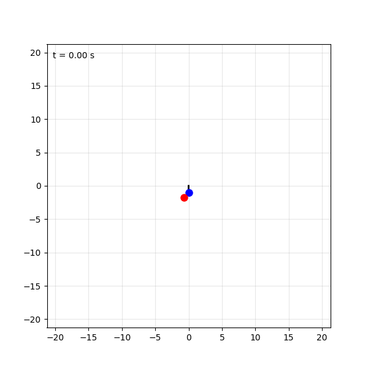

# double-pendulum-simulation-in-python-
Used sympy,scipy,numpy and matplotlib to simulate a double pendulum in python using the Euler Lagrange Equations

## Acknowledgement

This project was done by following the **Mr P Solver** YouTube tutorials on
double pendulum simulation in Python. The method (deriving the Lagrangian in
SymPy, solving for the accelerations, lambdifying, and integrating with
`odeint`) comes from those tutorials. I extended the idea from a rigid double
pendulum to a spring version by adding a radial stretch coordinate for each arm.

Channel: Mr P Solver on YouTube (https://youtu.be/SZdZeT93C1s?si=dmgoQvH2IZKooXEa)

## System

- Two point masses, each of mass `m`
- Generalised coordinates: `theta1, theta2` (angles) and `r1, r2` (spring
  extension beyond a natural length of 1)
- Arm lengths are `1 + r1` and `1 + r2`
- Gravity `g` acts downward, spring constant `k` for both springs

Lagrangian: `L = T - V`, where

- `T = 1/2 m (v1^2 + v2^2)`
- `V = m g y1 + m g y2 + 1/2 k (r1^2 + r2^2)`

## Method

1. Define the positions of both masses in terms of the four coordinates (SymPy)
2. Build the Lagrangian and get the four Euler-Lagrange equations
3. Solve them for `theta1'', theta2'', r1'', r2''`
4. Convert to fast numerical functions with `lambdify`
5. Integrate the 8-variable first-order system with `scipy.integrate.odeint`
6. Plot the states and animate the motion with matplotlib

## Parameters used

| Parameter | Value |
|-----------|-------|
| m | 1.0 |
| g | 9.81 |
| k | 10.0 |
| Initial state | theta1 = pi/2, theta2 = 3pi/4, r1 = r2 = 0, v1 = v2 = 5 |
| Time span | 0 to 20 s |

## Results

- Time histories of all eight states (`results.png`)
- Animation of the motion with the path of the lower mass (`double_spring_pendulum.gif`)



TODO: energy conservation plot and drift value (`T + V` should be constant, no damping)

## Observations

- The angular velocities spike when an arm is compressed (`1 + r` small). This
  is consistent with angular momentum conservation: the angular velocity
  scales roughly as `1 / (1 + r)^2`.
- The initial radial velocity is large for this stiffness, so the springs
  stretch and compress by a lot.

## Limitations

- Point masses, massless springs, no damping
- Only one initial condition has been run so far
- The model is singular when `1 + r` approaches 0
- TODO: energy conservation has not yet been verified

## Possible next steps

- Energy drift check and solver tolerance study
- Comparison with the linearised normal-mode frequencies
- Sensitivity to initial conditions (chaos)
- Add damping

## How to run

```bash
pip install numpy sympy scipy matplotlib pillow
python pendulum.py
```

The script saves `double_spring_pendulum.gif` in the same folder.

## Tools

Python, NumPy, SymPy, SciPy, Matplotlib
